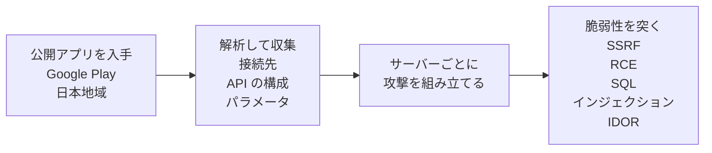

# a2b-verify

**A2B攻撃について、NICT と OWASP の一次情報の記載を原文と筆者訳でまとめたもの ── 引用は同梱のスクリプトで取り直せる**

Android や iOS のアプリ、Web サービスの API を運用する開発者とセキュリティ担当が、点検と対策の根拠を一次情報で確かめるための資料  
引用は 2026-10-15 にスクリプトを実行して取得した内容

## 概要

A2B攻撃（App-to-Backend Attack）は、公開アプリの解析結果を用いてバックエンドサーバを攻撃する手口  
[NICT](https://www.nict.go.jp/)（情報通信研究機構）の脅威情報分析チーム LETTICE が、2026-10-13 の注意喚起でこの手口を A2B攻撃と呼んで公表、同じ日に[総務省も注意喚起](https://www.soumu.go.jp/menu_kyotsuu/important/kinkyu02_000680.html)を出している  
LETTICE は、NICT のサイバーセキュリティネクサス（CYNEX）で2024年2月に発足した、脅威情報の共同分析チーム（NICT の資料の記載）



NICT の資料の本文に書いてある流れを図にしたもの ── PDF の図1 はテキストとして抽出できないので、本文から描き起こした  
NICT は、国内で相次ぐ情報漏洩事案の原因の一つとして、この手口による情報の不正取得を確認したと書いている

<details>
<summary>原文</summary>

> 国内で相次ぐ情報漏洩事案の原因の一つとして、こうした攻撃手法による情報の不正取得が確認されており、Androidアプリを公開している事業者には早急な対応が求められます

> 今回確認された攻撃では、攻撃者はまず、Google Playの日本地域で公開されているAndroidアプリを入手し、そのプログラムを解析することで、アプリが通信するバックエンドサーバの接続先、API（Application Programming Interface）の構成、通信に使用するパラメータなどの情報を収集します

> そのうえで、収集した情報を基に、個々のバックエンドサーバの構成やAPIの仕様に応じた攻撃を組み立て、脆弱性を狙った攻撃を実行しています

</details>

## 調査対象

- [NICT CYNEX の注意喚起のページ](https://cynex.nict.go.jp/library/261013-01.html)から辿れる [PDF](https://cynex.nict.go.jp/pdf/library/lettice/261013-01.pdf) ── 7ページ、Rev 1.1（PDF の表記で 10/13 15:00 更新）、通読1回
- [OWASP](https://owasp.org/) の [MASVS](https://github.com/OWASP/masvs)（Mobile Application Security Verification Standard）── モバイルアプリのセキュリティ検証の標準
- OWASP の [MASWE](https://github.com/OWASP/maswe)（Mobile Application Security Weakness Enumeration）── モバイルアプリの弱点の列挙
- OWASP の [API Security Top 10](https://api-security.owasp.org/) ── API でよくあるセキュリティリスクを10件に絞って並べた文書
- OWASP の [WSTG](https://wstg.owasp.org/latest/)（Web Security Testing Guide）── Web アプリケーションの試験手順書、点検表から試し方の参考としてリンクするだけで、README には引用しない

## 調査結果の要旨

- 主に狙われているのは、バックエンドサーバ側の SSRF（サーバーに意図しない通信をさせる）、RCE（サーバー上で不正なコードを実行させる）、SQLインジェクション、IDOR（識別子を変えると他人のデータに触れられる認可不備）── [狙われる脆弱性](#狙われる脆弱性)
- Android アプリに限らず、iOS アプリと Web サービス、ログイン後に使う API も対象 ── [対象範囲](#対象範囲)
- NICT は、侵害の確認、脆弱性の点検、暫定的な緩和策の早急な実施を求めている ── 確かめる項目と試し方の参考は[点検表](#点検表)に一覧
- 恒久対策について NICT と MASVS のコントロールが書くのは、サーバー側で認証・認可を行うことまで ── 認可の原則は API Security Top 10 の API1:2023 にある、詳しくは[恒久対策](#恒久対策)
- 公開アプリの解析は完全には防げず、解析されても安全なサーバーにすることが重要、と NICT は書く ── [解析への対策](#解析への対策)

筆者の見解の要点は、アプリ側の対策では狙われる4種類の脆弱性は塞がらず、守る場所はサーバー側の認可 ── 根拠と詳細は[考察](#考察)

## 点検表

一次情報の項目を、点検する側の順に筆者が並べ替えたもの ── 確かめ方の中身は出典の範囲で、一次情報に無いことは足していない  
試し方の参考は、各行に当たる OWASP WSTG のページの試験 ID（リンクにカーソルを乗せるとページ名が出る）、該当するページが無い行はなし

| 確かめること | 確かめ方 | 出典 | 試し方の参考（OWASP WSTG） |
|---|---|---|---|
| 公開ホストの洗い出し | アプリが使う API、サブドメイン、旧バージョンの API、検証環境、クラウド上の公開サービスまで列挙する | [侵害の確認](#侵害の確認) | [WSTG-INFO-04](https://wstg.owasp.org/latest/4-Web_Application_Security_Testing/01-Information_Gathering/04-Attack_Surface_Identification/ "Attack Surface Identification") |
| ログと IoC の照合 | 2026年8月以降のアクセスログ、API ログ、認証ログを、IoC（IP アドレス、User-Agent など）と照らす | [侵害の確認](#侵害の確認) | なし |
| 通常と異なる API 操作 | 認証なしでの大量取得、連番IDを使ったアクセス、他会員情報の閲覧・変更、認証トークンの不審な発行、管理機能の利用が無いか見る | [侵害の確認](#侵害の確認) | なし |
| 認可不備（IDOR） | 会員IDなどの識別子を他人のものに変えて、他者や他テナントの情報を閲覧・変更できないか確かめる | [脆弱性の点検](#脆弱性の点検) | [WSTG-APIT-02](https://wstg.owasp.org/latest/4-Web_Application_Security_Testing/12-API_Testing/02-API_Broken_Object_Level_Authorization/ "API Broken Object Level Authorization") |
| 認可の確認漏れ | クライアントの入力でデータベースのレコードに触れる全ての関数で、ログイン中のユーザーにその操作の権限があるかを確かめているか見る | [恒久対策](#恒久対策) | [WSTG-ATHZ-02](https://wstg.owasp.org/latest/4-Web_Application_Security_Testing/05-Authorization/02-Bypassing_Authorization_Schema/ "Bypassing Authorization Schema") |
| 識別子の推測しやすさ | ID が連番など、推測・列挙できる値になっていないか見る | [狙われる脆弱性](#狙われる脆弱性) | [WSTG-ATHZ-04](https://wstg.owasp.org/latest/4-Web_Application_Security_Testing/05-Authorization/04-Insecure_Direct_Object_References/ "Insecure Direct Object References") |
| レコードの ID の値 | ID にランダムで予測できない値（GUID など）を使っているか見る | [恒久対策](#恒久対策) | なし |
| 認可のテスト | 認可の仕組みの脆弱性を確かめるテストがあり、テストが失敗する変更をデプロイしない仕組みか見る | [恒久対策](#恒久対策) | なし |
| 認証の回避 | 認証回避ができないか確かめる | [脆弱性の点検](#脆弱性の点検) | [WSTG-ATHN-04](https://wstg.owasp.org/latest/4-Web_Application_Security_Testing/04-Authentication/04-Bypassing_Authentication_Schema/ "Bypassing Authentication Schema") |
| 認証トークンとセッション | 認証トークンの不正発行や偽造、他者の認証情報の取得ができないか確かめる | [脆弱性の点検](#脆弱性の点検) | [WSTG-SESS-01](https://wstg.owasp.org/latest/4-Web_Application_Security_Testing/06-Session_Management/01-Session_Management_Schema/ "Session Management Schema") |
| 固定された認証情報や暗号鍵 | 固定された認証情報や暗号鍵が露出していないか見る | [脆弱性の点検](#脆弱性の点検) | なし |
| SQL インジェクション | 外部入力を介してデータベースの情報を不正に取得・変更できないか確かめる | [脆弱性の点検](#脆弱性の点検) | [WSTG-INJT-05](https://wstg.owasp.org/latest/4-Web_Application_Security_Testing/07-Injection/05-SQL_Injection/ "SQL Injection") |
| NoSQL インジェクション | 外部入力を介して NoSQL のデータベースの情報を不正に取得・変更できないか確かめる | [脆弱性の点検](#脆弱性の点検) | [NoSQL Injection](https://wstg.owasp.org/latest/4-Web_Application_Security_Testing/07-Injection/05.6-NoSQL_Injection/ "WSTG-INJT-05 SQL Injection の下位の節、試験 ID は無い") |
| SSRF | URL 取得、画像処理、文書変換などの機能から、内部ネットワーク、クラウドのメタデータサービス、ローカルファイルに届かないか確かめる | [脆弱性の点検](#脆弱性の点検) | [WSTG-INJT-19](https://wstg.owasp.org/latest/4-Web_Application_Security_Testing/07-Injection/19-Server-Side_Request_Forgery/ "Server-Side Request Forgery") |
| クラウドの設定 | S3、GCS、Firestore などに、認証なしや本来許可されていない権限でアクセスできないか確かめる | [脆弱性の点検](#脆弱性の点検) | [WSTG-CONF-11](https://wstg.owasp.org/latest/4-Web_Application_Security_Testing/02-Configuration_and_Deployment_Management/11-Cloud_Storage/ "Cloud Storage") |
| デシリアライズ | 危険なデシリアライズが無いか見る | [脆弱性の点検](#脆弱性の点検) | [WSTG-INJT-23](https://wstg.owasp.org/latest/4-Web_Application_Security_Testing/07-Injection/23-Insecure_Deserialization/ "Insecure Deserialization") |
| 任意ファイルの書き込み | 任意ファイルの書き込みや上書きができないか見る | [脆弱性の点検](#脆弱性の点検) | なし |
| 管理機能の公開 | 不適切な管理機能の公開が無いか見る | [脆弱性の点検](#脆弱性の点検) | [WSTG-CONF-05](https://wstg.owasp.org/latest/4-Web_Application_Security_Testing/02-Configuration_and_Deployment_Management/05-Enumerate_Infrastructure_and_Application_Admin_Interfaces/ "Enumerate Infrastructure and Application Admin Interfaces") |

攻撃が疑われるときに取る手当ては[暫定的な緩和策](#暫定的な緩和策)

## 調査結果

各見出しの冒頭は一次情報の記載の要約、原文は折りたたみの中

### 対象範囲

NICT の資料は Android アプリを公開する事業者に向けたものだが、iOS アプリと Web サービスのバックエンドAPI でも同じ問題が起こりうると書いている  
ログインしないと使えない API も攻撃対象になりうる

<details>
<summary>原文</summary>

> 同様の問題はAndroidアプリに限らず、iOSアプリやWebサービスのバックエンドAPIでも発生する可能性がある

> 認証を必要としないAPIだけでなく、利用者アカウントによる認証後に利用できるAPIも攻撃対象となる場合があります

</details>

### 狙われる脆弱性

今回の攻撃で主に探索・悪用されているのは SSRF、RCE、SQLインジェクション、IDOR の4種類  
IDOR は BOLA とも呼ばれ、識別子が推測・列挙しやすいと大量の情報漏洩につながるおそれがある  
略語は、SSRF が Server-Side Request Forgery、RCE が Remote Code Execution、IDOR が Insecure Direct Object Reference（いずれも NICT の資料の見出しから）

<details>
<summary>原文</summary>

> 今回確認されたA2B攻撃では、主に以下の4種類の脆弱性が探索・悪用の対象となっています

> - SSRFは、外部からのリクエストによって、バックエンドサーバに本来意図していない通信を行わせる脆弱性です
> - RCEは、外部からのリクエストによって、バックエンドサーバ上で不正なコマンドやプログラムを実行できる脆弱性です
> - SQLインジェクションは、APIなどへの入力を通じて、バックエンドのデータベースに対する不正なSQL処理を実行させる脆弱性です
> - IDORは、APIなどで利用者IDやデータIDといった識別子を指定する際に、適切なアクセス権限の確認が行われていないことで発生する脆弱性です。同様の問題をBOLA（Broken Object Level Authorization：オブジェクト単位の認可不備）とも呼びます

> 識別子が容易に推測・列挙できる場合には、大量の情報漏洩につながるおそれがあります

</details>

### 侵害の確認

NICT が推奨する対策は、侵害の確認、脆弱性の点検、暫定的な緩和策の順に並び、早急な実施を求めている  
侵害の確認の項目は[点検表](#点検表)にある、出典が侵害の確認の行  
IoC は Indicators of Compromise（侵害指標）の略

<details>
<summary>原文</summary>

> - APIおよびインターネット上に公開しているホストを列挙してください。対象には、アプリが利用するAPI、サブドメイン、旧バージョンのAPI、検証環境、クラウド上の公開サービスなども含めてください
> - 2026年8月以降のアクセスログ、APIログ、認証ログなどを確認し、把握されているIoC（IPアドレス、User-Agent等）との一致や不審なアクセスの有無を調査してください。可能であれば、それ以前のログも確認してください
> - IoCとの一致に加え、認証なしでの大量の情報取得、連番IDなどを使ったアクセス、他会員情報の閲覧・変更、認証トークンの不審な発行、管理機能の利用など、通常と異なるAPI操作がないか確認してください
> - 不審なアクセスが確認された場合は、認証の成否、アクセス先のデータ、情報の取得・変更、認証情報の悪用など、影響の有無と範囲を速やかに調査してください

</details>

### 脆弱性の点検

狙われる4種類を重点的に点検するよう推奨している  
点検の項目は[点検表](#点検表)にある、出典が脆弱性の点検の行

<details>
<summary>原文</summary>

> 特に、SSRF、RCE、SQLインジェクション、IDORの4種類の脆弱性について、バックエンドAPIの安全性を重点的に点検することを推奨します

> - 認可不備（IDOR/BOLA）：会員IDなどの識別子を変更することで、他者や他テナントの情報を閲覧・変更できないか確認してください
> - 認証・セッション管理の不備：認証トークンの不正発行、偽造、他者の認証情報の取得、認証回避などが可能でないか確認してください。また、固定された認証情報や暗号鍵が露出していないか確認してください
> - SQLインジェクション・NoSQLインジェクション：外部入力を介してデータベースの情報を不正に取得・変更できないか確認してください
> - SSRF：URL取得、画像処理、文書変換などの機能を通じて、内部ネットワーク、クラウドのメタデータサービス、ローカルファイルなどへアクセスできないか確認してください
> - クラウドサービス・ストレージの設定不備： S3、GCS、Firestoreなどのサービスに、認証なし、または本来許可されていない権限でアクセスできないか確認してください
> - コード実行・ファイル操作に関する脆弱性：危険なデシリアライズ、任意ファイルの書き込み・上書き、不適切な管理機能の公開などがないか確認してください

</details>

### 暫定的な緩和策

被害の発生や拡大を防ぐ手当てとして、アクセス元の制限、不要な公開API・管理機能・検証環境の停止、監視とレート制限や WAF、認証情報の無効化と再発行、脆弱性の修正を挙げている  
直ちに修正できないときは、該当する API や機能、必要に応じてサービス全体の一時停止を検討するよう書いている  
WAF は Web Application Firewall（Web アプリケーションへの攻撃を通信の段階で遮断する仕組み）

<details>
<summary>原文</summary>

> - 国外からのアクセスや不要なアクセス元からの通信を一時的に制限してください
> - 不要な公開API、管理機能、検証環境へのアクセスを停止または制限してください
> - APIに対するアクセス頻度や連続的な識別子の指定などを監視し、必要に応じてレート制限やWAF等によるアクセス制御を行ってください
> - 認証情報やトークンの漏洩・悪用が疑われる場合は、該当する認証情報の無効化・再発行などを実施してください
> - 脆弱性が確認された場合は速やかに修正してください。直ちに修正できない場合や、重大な脆弱性の有無を確認できず、暫定的な制限でもリスクを許容可能な水準まで低減できない場合は、該当するAPIや機能、必要に応じてサービス全体の一時停止を検討してください

</details>

### 恒久対策

- NICT ── 恒久的な対策に触れているのは1か所だけ（PDF を通読1回、[verify/nict.py](verify/nict.py) の出力でも「恒久」を含む箇所は1つ）  
  攻撃者がアプリを介さずに API を直接操作できる前提で、サーバー側で適切な認証・認可と入力値の検証を行うこと、までを書き、実装の方法は書いていない
- MASVS ── コントロール（要求項目）24件のうち、サーバー側を指す語（`remote endpoint` `server` `backend`）を含むものは5件  
  認可の強制に触れているのは [MASVS-AUTH-1](https://github.com/OWASP/masvs/blob/master/controls/MASVS-AUTH-1.md) だけで、書いているのは強制をサーバー側で行うこと、まで
- [API Security Top 10 の API1:2023 Broken Object Level Authorization](https://api-security.owasp.org/editions/2023/en/0xa1-broken-object-level-authorization/)（BOLA）  
  認可の原則として、ユーザーのポリシーに基づく認可の実装、クライアントの入力でレコードに触れる全ての関数での認可の確認、予測できない ID、認可のテストを挙げている

<details>
<summary>NICT の原文</summary>

> 恒久的な対策としてシステムの設計・実装を見直す際には、攻撃者がアプリを介さずにAPIを直接操作できることを踏まえ、アプリ側の制御のみに依存せず、バックエンドサーバ側で適切な認証・認可や入力値の検証などを実施することが重要です

</details>

<details>
<summary>MASVS-AUTH-1 の原文と筆者訳、残りの4件</summary>

> While the enforcement of these mechanisms must be on the remote endpoint, the apps also have to ensure that it follows all the relevant best practices to ensure a secure use of the involved protocols.

筆者訳 ── 認証・認可の仕組みの強制はサーバー側（remote endpoint）で行う必要があり、そのうえでアプリ側も、使うプロトコルを安全に扱うための関連するベストプラクティスに全部従う必要がある

サーバー側を指す語を含む残りの4件は、サーバー側の認可に触れていない

| コントロール | 書いてあること |
|---|---|
| MASVS-AUTH-2 | ローカル認証（生体認証や端末内のPIN） |
| MASVS-NETWORK-1 | TLS（通信の暗号化の仕組み）による通信の保護 |
| MASVS-NETWORK-2 | ピンニング（接続先サーバーの証明書や公開鍵をアプリ側で固定すること） |
| MASVS-STORAGE-1 | 端末に保存するデータの出どころ |

</details>

<details>
<summary>API1:2023 の How To Prevent（防ぎ方）の原文と筆者訳</summary>

> - Implement a proper authorization mechanism that relies on the user policies and hierarchy.
> - Use the authorization mechanism to check if the logged-in user has access to perform the requested action on the record in every function that uses an input from the client to access a record in the database.
> - Prefer the use of random and unpredictable values as GUIDs for records' IDs.
> - Write tests to evaluate the vulnerability of the authorization mechanism. Do not deploy changes that make the tests fail.

筆者訳

- ユーザーのポリシーと階層に基づいた、適切な認可の仕組みを実装する
- クライアントからの入力でデータベースのレコードにアクセスする全ての関数で、ログイン中のユーザーがそのレコードに対して要求された操作を行えるかを、認可の仕組みで確かめる
- レコードの ID には、GUID（重複しないように生成する識別子）のようなランダムで予測できない値を使うほうがよい
- 認可の仕組みの脆弱性を確かめるテストを書き、テストが失敗する変更はデプロイしない

</details>

### アプリ側の対策

アプリ側でできる対策の例と、対応する OWASP の項目  
MASWE は弱点の列挙、MASVS は要求事項で、別の文書

| 該当箇所 | 対策 |
|---|---|
| [MASWE-0004](https://github.com/OWASP/maswe/blob/main/weaknesses/MASVS-STORAGE/MASWE-0004.md) Sensitive Data Hardcoded in the App Package | 鍵をハードコードしない |
| [MASWE-0004](https://github.com/OWASP/maswe/blob/main/weaknesses/MASVS-STORAGE/MASWE-0004.md) Sensitive Data Hardcoded in the App Package | 検証用のURLをリリースに入れない |
| [MASWE-0005](https://github.com/OWASP/maswe/blob/main/weaknesses/MASVS-STORAGE/MASWE-0005.md) Insertion of Sensitive Data into Logs | デバッグログを残さない |
| [MASWE-0061](https://github.com/OWASP/maswe/blob/main/weaknesses/MASVS-RESILIENCE/MASWE-0061.md) Debug Artifacts Not Removed | デバッグログを残さない |
| [MASVS-AUTH-1](https://github.com/OWASP/masvs/blob/master/controls/MASVS-AUTH-1.md)（MASVS のコントロール） | 認可の判定をアプリ内で完結させない |

<details>
<summary>要求の原文（requirement）と筆者訳</summary>

| 該当箇所 | 要求の原文（requirement） | 筆者訳 |
|---|---|---|
| [MASWE-0004](https://github.com/OWASP/maswe/blob/main/weaknesses/MASVS-STORAGE/MASWE-0004.md) Sensitive Data Hardcoded in the App Package | The app does not hardcode sensitive data in the application package. | アプリのパッケージに機密データをハードコードしない |
| [MASWE-0005](https://github.com/OWASP/maswe/blob/main/weaknesses/MASVS-STORAGE/MASWE-0005.md) Insertion of Sensitive Data into Logs | The app excludes sensitive data from application logs. | アプリのログから機密データを除く |
| [MASWE-0061](https://github.com/OWASP/maswe/blob/main/weaknesses/MASVS-RESILIENCE/MASWE-0061.md) Debug Artifacts Not Removed | The app does not contain debug artifacts. | アプリにデバッグ用の残し物を含めない |

MASVS-AUTH-1 の原文と筆者訳は[恒久対策](#恒久対策)の折りたたみの中

</details>

<details>
<summary>鍵、検証用のURL、デバッグログが含まれる根拠の原文と筆者訳</summary>

MASWE-0004 の Overview

> The hardcoded sensitive data may include API keys and secrets for first- or third-party services, credentials such as passwords or session tokens, and cryptographic material such as symmetric or private keys embedded directly in the package

筆者訳 ── ハードコードされた機密データには、自社や他社のサービスの API キーやシークレット、パスワードやセッショントークンなどの認証情報、パッケージに直接埋め込まれた共通鍵や秘密鍵などの暗号の材料が含まれうる

> It also includes developer leftover artifacts, such as staging or integration URLs, developer emails and usernames, and source code files left in the package

筆者訳 ── 開発者の残し物も含まれる、ステージングや結合テスト用のURL、開発者のメールアドレスやユーザー名、パッケージに残ったソースコードのファイルなど

MASWE-0005 と MASWE-0061 の Modes of Introduction

> Verbose Logging in Production: Shipping release builds with debug or verbose log levels still enabled

筆者訳 ── 本番での詳細なログ出力、デバッグ用や詳細のログレベルを有効にしたままリリースビルドを出すこと（MASWE-0005）

> Verbose Logging and Debug Flows: Leaving verbose or debug-level logging and diagnostic code paths active in production builds.

筆者訳 ── 本番ビルドで、詳細ログやデバッグ用のログ、診断用のコードを有効なまま残すこと（MASWE-0061）

</details>

<details>
<summary>MASWE-0004 と MASWE-0061 の役割の違い、表から外した MASWE-0063</summary>

MASWE-0004 と MASWE-0061 の役割の違い ── MASWE-0061 の Overview に明記

> Note the distinction from @MASWE-0004: that weakness covers developer leftover artifacts that leak confidentiality (staging URLs, developer identities, source files), while this one covers debug artifacts that weaken the app's resilience.

筆者訳 ── MASWE-0004 との違い、あちらは機密性を損なう開発者の残し物（ステージングURL、開発者の身元、ソースファイル）を扱い、こちらはアプリの耐性を弱めるデバッグ用の残し物を扱う

MASWE-0063 Debug Mechanisms Not Disabled も中身を見たが、`android:debuggable` などのデバッグ機能を本番で有効にしたままにする弱点で、ログやURLの話ではないので表から外した

</details>

### 解析への対策

NICT は、公開アプリの解析を完全に防ぐのは困難で、アプリの内部構造や API の仕様が知られてもバックエンドサーバの安全性が保たれるように設計・運用することが重要と書いている

<details>
<summary>原文</summary>

> 公開アプリが解析されること自体を完全に防ぐことは困難です。重要なのは、アプリの内部構造やAPIの仕様が攻撃者に知られた場合でも、バックエンドサーバの安全性が確保されるように設計・運用することです

</details>

## 考察

筆者の見解 ── 一次情報に無く、筆者が足したもの、一次情報と同じ場所に並べると OWASP や NICT の記載と誤読されるので、この節に分ける  
各項目の根拠は、調査結果のどこに当たるかで示す

- **直す順番はサーバーが先**  
  アプリ側の直しは次のリリースからしか効かない、強制アップデートの仕組みを持っていれば別  
  根拠 ── 攻撃者はアプリを介さずに API を直接操作できる（[恒久対策](#恒久対策)）、解析自体は完全には防げない（[解析への対策](#解析への対策)）
- **認可の指定が無いエンドポイントは、サーバーの起動時にエラーで止める**  
  ルーターに登録するとき、誰が触れるかの指定が無ければサーバーを立ち上げない、ログイン前に誰でも叩くAPIは誰でも可と宣言させて書き忘れと区別する  
  根拠 ── API1:2023 は、クライアントの入力でレコードに触れる全ての関数で認可を確かめるよう求めている（[恒久対策](#恒久対策)）、全ての関数を人の目で漏れなく見るより、書き忘れを起動時に機械的に止めるほうが確実、というのが筆者の判断
- **識別子をランダムにするのは補助で、認可の代わりにならない**  
  予測できない ID は推測・列挙による大量取得を難しくするが、ID を一つでも知られれば認可の確認だけが頼り  
  根拠 ── API1:2023 は GUID を Prefer（使うほうがよい）で挙げ、その前に認可の仕組みの実装と全関数での確認を置いている（[恒久対策](#恒久対策)）、NICT も推測・列挙しやすい識別子を、被害が大きくなる条件として書いている（[狙われる脆弱性](#狙われる脆弱性)）
- **アプリ側の対策では、狙われる4種類の脆弱性は塞がらない**  
  鍵のハードコードを避けるのは、点検項目の固定された認証情報や暗号鍵の露出に当たりうる、アプリに埋め込んだ鍵は解析で取り出せるため  
  検証用のURLとデバッグログを残さないのは、攻撃の手がかりを減らすもので、4種類そのものは塞がない  
  認可の判定をアプリ内で完結させないのは IDOR への対策そのもの、ただし実際に守るのはサーバー側の実装  
  根拠 ── 4種類はどれもバックエンドサーバ側の脆弱性（[狙われる脆弱性](#狙われる脆弱性)）、アプリ側の対策に対応する OWASP の項目はアプリ内の弱点（[アプリ側の対策](#アプリ側の対策)）

## 調査の範囲外と未確認事項

- NICT が挙げている IoC のIPアドレスの正当性 ── 資料に載っているものをそのまま扱っている
- どの事案が A2B攻撃によるものか ── NICT の資料は、国内の情報漏洩事案の原因の一つとしてこの手法を確認した、までを書いている
- NICT の PDF の図 ── テキストとして抽出できる部分だけを読んでいる
- MASVS のコントロール以外の文書 ── [verify/masvs.py](verify/masvs.py) が取得するのは `controls/` の24件だけ
- MASVS がサーバー側を [OWASP ASVS](https://github.com/OWASP/ASVS) に委譲しているという説 ── 二次情報では見かけたが、MASVS のリポジトリ内に該当する記述を見つけられなかった
- 実際のアプリやサーバーの挙動 ── このリポジトリは文書の照合だけ

## 検証手順

```
git clone https://github.com/shumatsumonobu/a2b-verify.git
cd a2b-verify
python -m venv .venv
source .venv/bin/activate
pip install -r requirements.txt
python -I verify/links.py
python -I verify/check_readme.py
```

- [verify/links.py](verify/links.py) ── README にある全 URL が開けるか、リポジトリ内のリンク先と見出しがあるかを確かめる、1件でも失敗すれば終了コード 1
- [verify/check_readme.py](verify/check_readme.py) ── 一次情報を取り直すスクリプトを全部実行し、README の引用が出力に原文どおり出ているかを照合する、1件でも無ければ終了コード 1
- `-I`（[Python の分離モード](https://docs.python.org/3/using/cmdline.html#cmdoption-I)）を付けると、スクリプトの隣や今いるディレクトリのファイルを import しない ── 取得したファイルに紛れたコードを読み込まないため

環境ごとの違い

- Windows の Git Bash では、有効化を `source .venv/Scripts/activate` にする
- Ubuntu で `python -m venv` が使えないとき（`python3-venv` が入っていないとき）は、[uv](https://github.com/astral-sh/uv) で `uv venv .venv` と `uv pip install --python .venv/bin/python -r requirements.txt` にする

動作を確かめた環境 ── 上の手順を各環境で1回実行

| 環境 | Python | 仮想環境の作り方 |
|---|---|---|
| Windows 11（Git Bash） | 3.13.4 | `python -m venv` |
| Ubuntu 24.04 on WSL | 3.13.15（`uv venv` が選んだもの） | `uv venv`（`python3-venv` が入っていなかった） |
| Ubuntu 24.04 on WSL | 3.12.3（システムの Python） | `uv venv --python /usr/bin/python3` |

3つとも PyMuPDF 1.28.2、macOS では試していない

スクリプトごとの役割、検索文字列、README の節との対応は [verify/README.md](verify/README.md)  
取得したファイルの索引は [data/README.md](data/README.md)

## ディレクトリ構成

```
a2b-verify/
├─ README.md
├─ CLAUDE.md            このリポジトリで作業するときの規約
├─ LICENSE              MIT
├─ requirements.txt     PyMuPDF
├─ verify/              取得と照合のスクリプト
│  ├─ README.md         スクリプトの説明
│  ├─ links.py          README にある全 URL の死活と、リポジトリ内のリンク先
│  ├─ nict.py           NICT の PDF を取得して該当箇所を文脈つきで表示
│  ├─ soumu.py          総務省の注意喚起のページから日付と該当箇所を表示
│  ├─ masvs.py          MASVS の全コントロールを取得して KEYWORDS で絞る
│  ├─ owasp_api.py      API1:2023 の How To Prevent を抽出
│  ├─ maswe.py          MASWE の該当する弱点を取得して requirement と該当箇所を表示
│  └─ check_readme.py   README の引用とスクリプトの出力を照合
└─ data/                実行時の取得物（README.md 以外は git の対象外）
   └─ README.md         取得物の索引
```

## Author

週末ものづくり部 ── [@shumatsumonobu](https://x.com/shumatsumonobu)

## License

MIT ── see [LICENSE](LICENSE)
