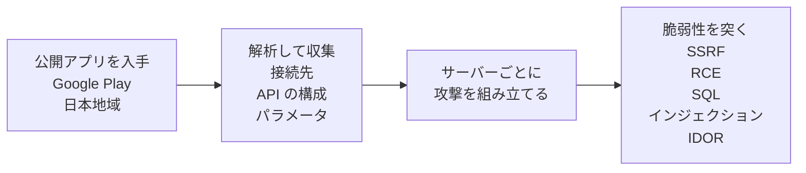

# a2b-verify

**A2B攻撃に備えて、自分のサービスで何を点検し、どこから直せばいいかを、NICT の注意喚起と OWASP の文書から原文つきでまとめたもの**

Android や iOS のアプリ、Web サービスの API を運用する開発者とセキュリティ担当に向けた資料  
ニュース記事などの要約ではなく、発行元の文書そのものから引いている（2026-10-15 時点）

この資料が答える問い

- 何を点検すればいいか ── NICT と OWASP の点検項目を、侵害されていないか → 狙われる脆弱性が無いか → 実装で防げているか、の順に並べた[点検表](#点検表)、各項目の試し方は OWASP の試験手順書にリンク
- サーバー側の認可（誰が何に触れてよいかの判定）をどう作ればいいか ── NICT と MASVS（OWASP のモバイルアプリの標準）が書くのはサーバー側で認証・認可を行うことまで、認可の仕組みの作り方の原則は OWASP API Security Top 10 の1番目の項目（API1:2023）にある（[恒久対策](#恒久対策)）
- どこから直せばいいか ── アプリ側の対策では狙われる脆弱性は塞がらず、先に直すのはサーバー側の認可、という筆者の判断と、その根拠（[考察](#考察)）

根拠の原文は[調査結果](#調査結果)に、この資料の書き写しをどう確かめたかは [verify/README.md](verify/README.md) に

## 概要

A2B攻撃（App-to-Backend Attack）は、公開アプリの解析結果を用いてバックエンドサーバを攻撃する手口

[NICT](https://www.nict.go.jp/)（情報通信研究機構）の脅威情報分析チーム LETTICE が 2026-10-13 の注意喚起でこの手口を A2B攻撃と呼び、国内で相次ぐ情報漏洩事案の原因の一つとして、A2B攻撃による情報の不正取得を確認したと書いている ── 同じ日に[総務省も注意喚起](https://www.soumu.go.jp/menu_kyotsuu/important/kinkyu02_000680.html)を出している

> 国内で相次ぐ情報漏洩事案の原因の一つとして、こうした攻撃手法による情報の不正取得が確認されており、Androidアプリを公開している事業者には早急な対応が求められます

攻撃の流れ（NICT の資料の本文から描いた図）



図の元になった NICT の原文

> 今回確認された攻撃では、攻撃者はまず、Google Playの日本地域で公開されているAndroidアプリを入手し、そのプログラムを解析することで、アプリが通信するバックエンドサーバの接続先、API（Application Programming Interface）の構成、通信に使用するパラメータなどの情報を収集します
>
> そのうえで、収集した情報を基に、個々のバックエンドサーバの構成やAPIの仕様に応じた攻撃を組み立て、脆弱性を狙った攻撃を実行しています

## 調査対象

この資料が引用している文書

- [NICT CYNEX の注意喚起のページ](https://cynex.nict.go.jp/library/261013-01.html)から辿れる [PDF](https://cynex.nict.go.jp/pdf/library/lettice/261013-01.pdf) ── 7ページ、Rev 1.1（PDF の表記で 10/13 15:00 更新）、通読1回  
  発行元の LETTICE は、NICT のサイバーセキュリティネクサス（CYNEX）で2024年2月に発足した脅威情報の共同分析チーム（NICT の資料の記載）
- [OWASP](https://owasp.org/) の [MASVS](https://github.com/OWASP/masvs)（Mobile Application Security Verification Standard）── モバイルアプリのセキュリティ検証の標準
- OWASP の [MASWE](https://github.com/OWASP/maswe)（Mobile Application Security Weakness Enumeration）── モバイルアプリの弱点の列挙
- OWASP の [API Security Top 10](https://api-security.owasp.org/) ── API でよくあるセキュリティリスクを10件に絞って並べた文書

点検表の各項目からは、試し方の参考として、OWASP の試験手順書 [WSTG](https://wstg.owasp.org/latest/)（Web Security Testing Guide）のページにリンクしている ── 中身は引用していない

書き写した文章が原文と一致していることは、元の文書をスクリプトで取り直して照合し、確かめてある（方法は [verify/README.md](verify/README.md)）── このリポジトリに、自分のサービスを調べるツールは入っていない

## 調査結果の要旨

- 主に狙われているのは、バックエンドサーバ側の SSRF（サーバーに意図しない通信をさせる）、RCE（サーバー上で不正なコードを実行させる）、SQLインジェクション、IDOR（識別子を変えると他人のデータに触れられる認可不備）── [狙われる脆弱性](#狙われる脆弱性)
- Android アプリに限らず、iOS アプリと Web サービス、ログイン後に使う API も対象 ── [対象範囲](#対象範囲)
- NICT は、侵害の確認、脆弱性の点検、暫定的な緩和策の早急な実施を求めている ── 確かめる項目は[点検表](#点検表)にまとめた
- 恒久対策（設計と実装の見直し）について NICT と MASVS が書くのは、サーバー側で認証・認可を行うことまで ── 認可の原則は API1:2023（BOLA、IDOR と同じ問題）にある、詳しくは[恒久対策](#恒久対策)
- 公開アプリの解析は完全には防げず、解析されても安全なサーバーにすることが重要、と NICT は書く ── [解析への対策](#解析への対策)

## 点検表

自分のサービスのバックエンドサーバと API が A2B攻撃に耐えるかを点検する表で、NICT の注意喚起と OWASP の文書にある点検項目を、点検する順に筆者が並べ替えた ── 確かめ方には、文書に無いことを足していない

- 出典 ── その行の根拠の原文を載せた、調査結果の見出し
- 試し方の参考 ── OWASP WSTG の該当ページ、試験 ID にカーソルを乗せるとページ名が出る、該当するページが無い行はなし
- 筆者注 ── 試すのは自分が管理するサービスだけにする、他人のサービスに試すと不正アクセスになりうる

**まず、侵害されていないか**

| 確かめること | 確かめ方 | 出典 | 試し方の参考（OWASP WSTG） |
|---|---|---|---|
| 公開ホストの洗い出し | アプリが使う API、サブドメイン、旧バージョンの API、検証環境、クラウド上の公開サービスまで列挙する | [侵害の確認](#侵害の確認) | [WSTG-INFO-04](https://wstg.owasp.org/latest/4-Web_Application_Security_Testing/01-Information_Gathering/04-Attack_Surface_Identification/ "Attack Surface Identification") |
| ログと IoC の照合 | 2026年8月以降のアクセスログ、API ログ、認証ログを、IoC（侵害指標、攻撃に使われた IP アドレスや User-Agent など）と照らす | [侵害の確認](#侵害の確認) | なし |
| 通常と異なる API 操作 | 認証なしでの大量取得、連番IDを使ったアクセス、他会員情報の閲覧・変更、認証トークンの不審な発行、管理機能の利用が無いか見る | [侵害の確認](#侵害の確認) | なし |

**次に、狙われる脆弱性が無いか**

| 確かめること | 確かめ方 | 出典 | 試し方の参考（OWASP WSTG） |
|---|---|---|---|
| 認可不備（IDOR） | 会員IDなどの識別子を他人のものに変えて、他者や他テナントの情報を閲覧・変更できないか確かめる | [脆弱性の点検](#脆弱性の点検) | [WSTG-APIT-02](https://wstg.owasp.org/latest/4-Web_Application_Security_Testing/12-API_Testing/02-API_Broken_Object_Level_Authorization/ "API Broken Object Level Authorization") |
| 認証の回避 | 認証を経ずに、ログインが必要な機能やデータに届かないか（認証回避）確かめる | [脆弱性の点検](#脆弱性の点検) | [WSTG-ATHN-04](https://wstg.owasp.org/latest/4-Web_Application_Security_Testing/04-Authentication/04-Bypassing_Authentication_Schema/ "Bypassing Authentication Schema") |
| 認証トークンとセッション | 認証トークンの不正発行や偽造、他者の認証情報の取得ができないか確かめる | [脆弱性の点検](#脆弱性の点検) | [WSTG-SESS-01](https://wstg.owasp.org/latest/4-Web_Application_Security_Testing/06-Session_Management/01-Session_Management_Schema/ "Session Management Schema") |
| 固定された認証情報や暗号鍵 | 固定された認証情報や暗号鍵が露出していないか見る | [脆弱性の点検](#脆弱性の点検) | なし |
| SQL インジェクション | 外部入力を介してデータベースの情報を不正に取得・変更できないか確かめる | [脆弱性の点検](#脆弱性の点検) | [WSTG-INJT-05](https://wstg.owasp.org/latest/4-Web_Application_Security_Testing/07-Injection/05-SQL_Injection/ "SQL Injection") |
| NoSQL インジェクション | 外部入力を介して NoSQL のデータベースの情報を不正に取得・変更できないか確かめる | [脆弱性の点検](#脆弱性の点検) | [NoSQL Injection](https://wstg.owasp.org/latest/4-Web_Application_Security_Testing/07-Injection/05.6-NoSQL_Injection/ "WSTG-INJT-05 SQL Injection の下位の節、試験 ID は無い") |
| SSRF | URL 取得、画像処理、文書変換などの機能から、内部ネットワーク、クラウドのメタデータサービス、ローカルファイルに届かないか確かめる | [脆弱性の点検](#脆弱性の点検) | [WSTG-INJT-19](https://wstg.owasp.org/latest/4-Web_Application_Security_Testing/07-Injection/19-Server-Side_Request_Forgery/ "Server-Side Request Forgery") |
| クラウドの設定 | S3、GCS、Firestore などに、認証なしや本来許可されていない権限でアクセスできないか確かめる | [脆弱性の点検](#脆弱性の点検) | [WSTG-CONF-11](https://wstg.owasp.org/latest/4-Web_Application_Security_Testing/02-Configuration_and_Deployment_Management/11-Cloud_Storage/ "Cloud Storage") |
| デシリアライズ | 受け取ったデータをプログラムのオブジェクトに戻す処理（デシリアライズ）に、危険な扱いが無いか見る | [脆弱性の点検](#脆弱性の点検) | [WSTG-INJT-23](https://wstg.owasp.org/latest/4-Web_Application_Security_Testing/07-Injection/23-Insecure_Deserialization/ "Insecure Deserialization") |
| 任意ファイルの書き込み | 任意ファイルの書き込みや上書きができないか見る | [脆弱性の点検](#脆弱性の点検) | なし |
| 管理機能の公開 | 不適切な管理機能の公開が無いか見る | [脆弱性の点検](#脆弱性の点検) | [WSTG-CONF-05](https://wstg.owasp.org/latest/4-Web_Application_Security_Testing/02-Configuration_and_Deployment_Management/05-Enumerate_Infrastructure_and_Application_Admin_Interfaces/ "Enumerate Infrastructure and Application Admin Interfaces") |

**最後に、実装で防げているか**

| 確かめること | 確かめ方 | 出典 | 試し方の参考（OWASP WSTG） |
|---|---|---|---|
| 認可の確認漏れ | クライアントの入力でデータベースのレコードに触れる全ての関数で、ログイン中のユーザーにその操作の権限があるかを確かめているか見る | [恒久対策](#恒久対策) | [WSTG-ATHZ-02](https://wstg.owasp.org/latest/4-Web_Application_Security_Testing/05-Authorization/02-Bypassing_Authorization_Schema/ "Bypassing Authorization Schema") |
| 識別子の推測しやすさ | ID が連番など、推測・列挙できる値になっていないか見る | [狙われる脆弱性](#狙われる脆弱性) | [WSTG-ATHZ-04](https://wstg.owasp.org/latest/4-Web_Application_Security_Testing/05-Authorization/04-Insecure_Direct_Object_References/ "Insecure Direct Object References") |
| レコードの ID の値 | ID にランダムで予測できない値（GUID など）を使っているか見る | [恒久対策](#恒久対策) | なし |
| 認可のテスト | 認可の仕組みの脆弱性を確かめるテストがあり、テストが失敗する変更をデプロイしない仕組みか見る | [恒久対策](#恒久対策) | なし |

攻撃が疑われるときに取る手当ては[暫定的な緩和策](#暫定的な緩和策)

## 調査結果

NICT と OWASP の文書に書いてあることを、テーマごとに原文で並べた ── 英語の原文には筆者訳を付けた

### 対象範囲

NICT の資料は Android アプリを公開する事業者に向けたものだが、対象はそれに限らないと書いている

> 同様の問題はAndroidアプリに限らず、iOSアプリやWebサービスのバックエンドAPIでも発生する可能性がある
>
> 認証を必要としないAPIだけでなく、利用者アカウントによる認証後に利用できるAPIも攻撃対象となる場合があります

### 狙われる脆弱性

NICT は、今回の攻撃で主に狙われている脆弱性を4種類挙げ、それぞれを次のように説明している ── 略語は、SSRF が Server-Side Request Forgery、RCE が Remote Code Execution、IDOR が Insecure Direct Object Reference

> 今回確認されたA2B攻撃では、主に以下の4種類の脆弱性が探索・悪用の対象となっています
>
> • SSRFは、外部からのリクエストによって、バックエンドサーバに本来意図していない通信を行わせる脆弱性です  
> • RCEは、外部からのリクエストによって、バックエンドサーバ上で不正なコマンドやプログラムを実行できる脆弱性です  
> • SQLインジェクションは、APIなどへの入力を通じて、バックエンドのデータベースに対する不正なSQL処理を実行させる脆弱性です  
> • IDORは、APIなどで利用者IDやデータIDといった識別子を指定する際に、適切なアクセス権限の確認が行われていないことで発生する脆弱性です。同様の問題をBOLA（Broken Object Level Authorization：オブジェクト単位の認可不備）とも呼びます
>
> 識別子が容易に推測・列挙できる場合には、大量の情報漏洩につながるおそれがあります

### 侵害の確認

NICT は、侵害の確認、脆弱性の点検、暫定的な緩和策の順に対策を挙げ、早急な実施を求めている ── 侵害の確認の項目は次のとおりで、点検表の、侵害されていないかを確かめる表の元になっている

> • APIおよびインターネット上に公開しているホストを列挙してください。対象には、アプリが利用するAPI、サブドメイン、旧バージョンのAPI、検証環境、クラウド上の公開サービスなども含めてください  
> • 2026年8月以降のアクセスログ、APIログ、認証ログなどを確認し、把握されているIoC（IPアドレス、User-Agent等）との一致や不審なアクセスの有無を調査してください。可能であれば、それ以前のログも確認してください  
> • IoCとの一致に加え、認証なしでの大量の情報取得、連番IDなどを使ったアクセス、他会員情報の閲覧・変更、認証トークンの不審な発行、管理機能の利用など、通常と異なるAPI操作がないか確認してください  
> • 不審なアクセスが確認された場合は、認証の成否、アクセス先のデータ、情報の取得・変更、認証情報の悪用など、影響の有無と範囲を速やかに調査してください

### 脆弱性の点検

NICT は、狙われる4種類を重点的に点検するよう推奨し、点検の項目を挙げている ── 点検表の、狙われる脆弱性が無いかを確かめる表の元になっている

> 特に、SSRF、RCE、SQLインジェクション、IDORの4種類の脆弱性について、バックエンドAPIの安全性を重点的に点検することを推奨します
>
> • 認可不備（IDOR/BOLA）：会員IDなどの識別子を変更することで、他者や他テナントの情報を閲覧・変更できないか確認してください  
> • 認証・セッション管理の不備：認証トークンの不正発行、偽造、他者の認証情報の取得、認証回避などが可能でないか確認してください。また、固定された認証情報や暗号鍵が露出していないか確認してください  
> • SQLインジェクション・NoSQLインジェクション：外部入力を介してデータベースの情報を不正に取得・変更できないか確認してください  
> • SSRF：URL取得、画像処理、文書変換などの機能を通じて、内部ネットワーク、クラウドのメタデータサービス、ローカルファイルなどへアクセスできないか確認してください  
> • クラウドサービス・ストレージの設定不備： S3、GCS、Firestoreなどのサービスに、認証なし、または本来許可されていない権限でアクセスできないか確認してください  
> • コード実行・ファイル操作に関する脆弱性：危険なデシリアライズ、任意ファイルの書き込み・上書き、不適切な管理機能の公開などがないか確認してください

### 暫定的な緩和策

被害の発生や拡大を防ぐ手当てとして、NICT が挙げているもの ── WAF は Web アプリケーションへの攻撃を通信の段階で遮断する仕組み

> • 国外からのアクセスや不要なアクセス元からの通信を一時的に制限してください  
> • 不要な公開API、管理機能、検証環境へのアクセスを停止または制限してください  
> • APIに対するアクセス頻度や連続的な識別子の指定などを監視し、必要に応じてレート制限やWAF等によるアクセス制御を行ってください  
> • 認証情報やトークンの漏洩・悪用が疑われる場合は、該当する認証情報の無効化・再発行などを実施してください  
> • 脆弱性が確認された場合は速やかに修正してください。直ちに修正できない場合や、重大な脆弱性の有無を確認できず、暫定的な制限でもリスクを許容可能な水準まで低減できない場合は、該当するAPIや機能、必要に応じてサービス全体の一時停止を検討してください

### 恒久対策

その場の手当てではなく、設計と実装を見直すときに何をすべきかについて、それぞれの文書が書いていること

**NICT** ── 恒久的な対策に触れているのは、PDF を通読した範囲で次の1か所だけで、認証・認可の実装の方法は書いていない

> 恒久的な対策としてシステムの設計・実装を見直す際には、攻撃者がアプリを介さずにAPIを直接操作できることを踏まえ、アプリ側の制御のみに依存せず、バックエンドサーバ側で適切な認証・認可や入力値の検証などを実施することが重要です

**MASVS** ── 認可の強制に触れている要求項目は [MASVS-AUTH-1](https://github.com/OWASP/masvs/blob/master/controls/MASVS-AUTH-1.md) だけで、書いているのは強制をサーバー側で行うこと、まで（MASVS では要求項目をコントロールと呼び、24件ある全部を確かめた）

> While the enforcement of these mechanisms must be on the remote endpoint, the apps also have to ensure that it follows all the relevant best practices to ensure a secure use of the involved protocols.

筆者訳 ── 認証・認可の仕組みの強制はサーバー側（remote endpoint）で行う必要があり、そのうえでアプリ側も、使うプロトコルを安全に扱うための関連するベストプラクティスに全部従う必要がある

24件のうち、サーバー側を指す語（`remote endpoint` `server` `backend`）を含む要求項目は5件で、MASVS-AUTH-1 以外の4件はサーバー側の認可に触れていない

| 要求項目 | 書いてあること |
|---|---|
| MASVS-AUTH-2 | ローカル認証（生体認証や端末内のPIN） |
| MASVS-NETWORK-1 | TLS（通信の暗号化の仕組み）による通信の保護 |
| MASVS-NETWORK-2 | ピンニング（接続先サーバーの証明書や公開鍵をアプリ側で固定すること） |
| MASVS-STORAGE-1 | 端末に保存するデータの出どころ |

**API Security Top 10** ── 認可の原則は、[API1:2023 Broken Object Level Authorization](https://api-security.owasp.org/editions/2023/en/0xa1-broken-object-level-authorization/)（BOLA）の How To Prevent（防ぎ方）に挙がっている

> • Implement a proper authorization mechanism that relies on the user policies and hierarchy.  
> • Use the authorization mechanism to check if the logged-in user has access to perform the requested action on the record in every function that uses an input from the client to access a record in the database.  
> • Prefer the use of random and unpredictable values as GUIDs for records' IDs.  
> • Write tests to evaluate the vulnerability of the authorization mechanism. Do not deploy changes that make the tests fail.

筆者訳

- ユーザーのポリシーと階層に基づいた、適切な認可の仕組みを実装する
- クライアントからの入力でデータベースのレコードにアクセスする全ての関数で、ログイン中のユーザーがそのレコードに対して要求された操作を行えるかを、認可の仕組みで確かめる
- レコードの ID には、GUID（重複しないように生成する識別子）のようなランダムで予測できない値を使うほうがよい
- 認可の仕組みの脆弱性を確かめるテストを書き、テストが失敗する変更はデプロイしない

### アプリ側の対策

アプリ側でできる対策で A2B攻撃を防げるかを見るため、対策の例が OWASP のどの項目に当たるかを並べた ── MASWE は弱点の列挙、MASVS は要求事項で、別の文書

| 該当箇所 | 対策 |
|---|---|
| [MASWE-0004](https://github.com/OWASP/maswe/blob/main/weaknesses/MASVS-STORAGE/MASWE-0004.md) Sensitive Data Hardcoded in the App Package | 鍵をハードコードしない |
| [MASWE-0004](https://github.com/OWASP/maswe/blob/main/weaknesses/MASVS-STORAGE/MASWE-0004.md) Sensitive Data Hardcoded in the App Package | 検証用のURLをリリースに入れない |
| [MASWE-0005](https://github.com/OWASP/maswe/blob/main/weaknesses/MASVS-STORAGE/MASWE-0005.md) Insertion of Sensitive Data into Logs | デバッグログを残さない |
| [MASWE-0061](https://github.com/OWASP/maswe/blob/main/weaknesses/MASVS-RESILIENCE/MASWE-0061.md) Debug Artifacts Not Removed | デバッグ用のコードや隠しスイッチをリリースに残さない |
| [MASVS-AUTH-1](https://github.com/OWASP/masvs/blob/master/controls/MASVS-AUTH-1.md)（MASVS の要求項目） | 認可の判定をアプリ内で完結させない |

MASWE の各項目が掲げる要求（requirement）── MASVS-AUTH-1 の原文と筆者訳は[恒久対策](#恒久対策)にある

| 該当箇所 | 要求の原文 | 筆者訳 |
|---|---|---|
| MASWE-0004 | The app does not hardcode sensitive data in the application package. | アプリのパッケージに機密データをハードコードしない |
| MASWE-0005 | The app excludes sensitive data from application logs. | アプリのログから機密データを除く |
| MASWE-0061 | The app does not contain debug artifacts. | アプリにデバッグ用の残し物を含めない |

**MASWE-0004** ── 鍵と検証用のURLが含まれる根拠（Overview）

> The hardcoded sensitive data may include API keys and secrets for first- or third-party services, credentials such as passwords or session tokens, and cryptographic material such as symmetric or private keys embedded directly in the package

筆者訳 ── ハードコードされた機密データには、自社や他社のサービスの API キーやシークレット、パスワードやセッショントークンなどの認証情報、パッケージに直接埋め込まれた共通鍵や秘密鍵などの暗号の材料が含まれうる

> It also includes developer leftover artifacts, such as staging or integration URLs, developer emails and usernames, and source code files left in the package

筆者訳 ── 開発者の残し物も含まれる、ステージングや結合テスト用のURL、開発者のメールアドレスやユーザー名、パッケージに残ったソースコードのファイルなど

**MASWE-0005** ── デバッグログが含まれる根拠（Modes of Introduction）

> Verbose Logging in Production: Shipping release builds with debug or verbose log levels still enabled

筆者訳 ── 本番での詳細なログ出力、デバッグ用や詳細のログレベルを有効にしたままリリースビルドを出すこと

**MASWE-0061** ── デバッグ用のコードや隠しスイッチが含まれる根拠と、MASWE-0004 との役割の違い（Overview）

> This weakness occurs when an app ships to production containing developer debug artifacts, such as verbose logging, testing utilities, debugging symbols, or leftover debug and test code.

筆者訳 ── 開発者のデバッグ用の残し物（詳細なログ、テスト用の道具、デバッグシンボル、残ったデバッグやテストのコード）を含んだまま本番に出すと起きる弱点

> most critically, may include backdoors, such as hidden switches enabling debug menus or an insecure trust manager, that can disable security controls like TLS certificate validation

筆者訳 ── 最も重大なのは、デバッグメニューを開く隠しスイッチや安全でないトラストマネージャーのような裏口を含みうることで、TLS の証明書検証などのセキュリティ制御を無効にしうる

> Note the distinction from @MASWE-0004: that weakness covers developer leftover artifacts that leak confidentiality (staging URLs, developer identities, source files), while this one covers debug artifacts that weaken the app's resilience.

筆者訳 ── MASWE-0004 との違い、あちらは機密性を損なう開発者の残し物（ステージングURL、開発者の身元、ソースファイル）を扱い、こちらはアプリの耐性を弱めるデバッグ用の残し物を扱う

表から外したもの ── MASWE-0063 Debug Mechanisms Not Disabled も中身を見たが、リリースに残る残し物ではなく、`android:debuggable` などでプラットフォームのデバッガを本番で使える設定のまま出す弱点で、表の対策とは別

### 解析への対策

NICT の注意喚起の結論

> 公開アプリが解析されること自体を完全に防ぐことは困難です。重要なのは、アプリの内部構造やAPIの仕様が攻撃者に知られた場合でも、バックエンドサーバの安全性が確保されるように設計・運用することです

## 考察

NICT と OWASP の文書には無く、筆者が足した見解で、原文と並べると NICT や OWASP の主張と誤読されるので、この節に分けた ── 各項目の根拠は、調査結果のどこに当たるかで示す

- **対策の順番はサーバー側が先**
  - アプリ側の直しは次のリリースからしか効かない、強制アップデートの仕組みを持っていれば別
  - 根拠 ── 攻撃者はアプリを介さずに API を直接操作できる（[恒久対策](#恒久対策)）、解析自体は完全には防げない（[解析への対策](#解析への対策)）
- **認可の指定が無いエンドポイントは、サーバーの起動時にエラーで止める**
  - ルーターに登録するとき、誰が触れるかの指定が無ければサーバーを立ち上げない、ログイン前に誰でも叩くAPIは誰でも可と宣言させて、認可の指定の書き忘れと区別する
  - 根拠 ── API1:2023 は、クライアントの入力でレコードに触れる全ての関数で認可を確かめるよう求めている（[恒久対策](#恒久対策)）、全ての関数を人の目で漏れなく見るより、書き忘れを起動時に機械的に止めるほうが確実、というのが筆者の判断
- **識別子をランダムにするのは補助で、認可の代わりにならない**
  - 予測できない ID は推測・列挙による大量取得を難しくするが、ID を一つでも知られれば認可の確認だけが頼り
  - 根拠 ── API1:2023 は GUID を Prefer（使うほうがよい）で挙げ、その前に認可の仕組みの実装と全関数での確認を置いている（[恒久対策](#恒久対策)）、NICT も推測・列挙しやすい識別子を、被害が大きくなる条件として書いている（[狙われる脆弱性](#狙われる脆弱性)）
- **アプリ側の対策では、狙われる4種類の脆弱性は塞がらない**
  - 鍵のハードコードは、NICT の点検項目にある、固定された認証情報や暗号鍵の露出に当たりうる ── アプリに埋め込んだ鍵は解析で取り出せるため
  - 検証用のURL、デバッグログ、デバッグ用のコードや隠しスイッチを残さないのは、攻撃の手がかりや抜け道を減らすもので、4種類そのものは塞がない
  - 認可の判定をアプリ内で完結させないのは IDOR への対策そのもの、ただし実際に守るのはサーバー側の実装
  - 根拠 ── 4種類はどれもバックエンドサーバ側の脆弱性（[狙われる脆弱性](#狙われる脆弱性)）、アプリ側の対策に対応する OWASP の項目はアプリ内の弱点（[アプリ側の対策](#アプリ側の対策)）

## 調査の範囲外と未確認事項

- NICT が挙げている IoC の IP アドレスの正当性 ── 資料に載っているものをそのまま扱っている
- どの事案が A2B攻撃によるものか ── NICT の資料は、国内の情報漏洩事案の原因の一つとしてこの手口を確認した、までを書いている
- NICT の PDF の図の中の記載 ── 引用しているのは本文だけ
- MASVS の要求項目以外の文書 ── 確かめたのは要求項目（`controls/`）の24件だけ
- MASVS がサーバー側を [OWASP ASVS](https://github.com/OWASP/ASVS) に委譲しているという説 ── ほかの解説記事では見かけたが、MASVS のリポジトリ内に該当する記述を見つけられなかった
- 実際のアプリやサーバーの挙動 ── この資料は文書を読んでまとめたもので、実際のアプリやサーバーは調べていない

## ディレクトリ構成

```
a2b-verify/
├─ README.md
├─ CLAUDE.md            このリポジトリで作業するときの規約
├─ LICENSE              MIT
├─ requirements.txt     照合スクリプトが使う PyMuPDF
├─ verify/              書き写しの照合スクリプト（説明は verify/README.md）
└─ data/                照合のときの取得物（説明は data/README.md、README.md 以外は git の対象外）
```

## Author

週末ものづくり部 ── [@shumatsumonobu](https://x.com/shumatsumonobu)

## License

MIT ── see [LICENSE](LICENSE)

- この資料に載せた OWASP の原文（MASVS、MASWE、API Security Top 10）と、その筆者訳は [CC BY-SA 4.0](https://creativecommons.org/licenses/by-sa/4.0/) ── 出典は本文の各リンク、筆者訳は原文を日本語に訳したもの
- NICT の原文は [NICT のサイトポリシー](https://www.nict.go.jp/policy/index.html)に沿って、出所を示して引用
