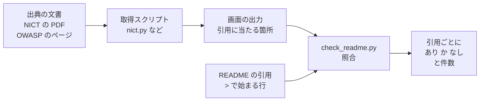

# verify

[README](../README.md) は NICT と OWASP の文書を書き写して作っている ── その書き写しが原文と一致しているかを確かめるスクリプトの置き場で、どのスクリプトも元の文書を取得するだけ、自分のサービスを調べるツールではない

## 目的

- README の点検表と要旨は、NICT と OWASP の文書を根拠にしている ── 根拠の書き写しが間違っていたら、点検表ごと信用できなくなる
- 実際、このリポジトリを作る途中でも、要約記事をもとに書いた記述が原文と食い違っていた ── NICT は原因を確定していない、と書いていたが、PDF には原因の一つとして確認されたとあった
- そこで書き写して終わりにせず、元の文書をスクリプトで取り直し、README の引用がそこに書いてあるかを毎回確かめる ── 出典の文書があとで改訂されたときも、ここで気づける

## 出力

- [check_readme.py](check_readme.py) を実行すると、README の引用ごとに あり（元の文書に見つかった）か なし（見つからない）が並び、最後に 出力に見つかった引用 43 / 43 件 のように件数が出る
- 全部見つかれば終了コード 0、1件でも なし があれば 1
- 実際の出力の例は[実行](#実行)の節にある

## 使う人

- README の書き写しが元の文書と一致しているかを、自分で確かめたい人
- README を書き直す人 ── 書き直したら check_readme.py を通す
- 同じ仕組みを自分の文書で使いたい人 ── [自分の文書で使う](#自分の文書で使う)

## 仕組み



- 取得スクリプトは出典ごとに1本 ── 出典の文書を取得し、`TARGETS`（検索文字列の一覧、masvs.py では `KEYWORDS`）に当たる箇所を画面に出す
- [check_readme.py](check_readme.py) は取得スクリプトを全部実行し、README の引用が、取り直した文書の該当箇所に一字一句そのまま含まれるかを確かめる ── 空白と改行は無視して比べる
- [links.py](links.py) は別枠で、3つの README（直下、verify/、data/）にある URL が開けるか、リポジトリ内のリンク先と見出しがあるかを確かめる

## 実行

リポジトリを取得し、仮想環境を作って実行する

```
git clone https://github.com/shumatsumonobu/a2b-verify.git
cd a2b-verify
python -m venv .venv
source .venv/bin/activate
pip install -r requirements.txt
python -I verify/links.py
python -I verify/check_readme.py
```

- [links.py](links.py) ── 1件でも開けない URL や、見つからないリンク先があれば終了コード 1
- [check_readme.py](check_readme.py) ── 取得スクリプトを順に実行するので、個別に走らせる必要は無い、1本ずつ出力を見たいときは `python -I verify/nict.py` のように直接実行する
- `-I`（[Python の分離モード](https://docs.python.org/3/using/cmdline.html#cmdoption-I)）を付けると、スクリプトの隣や今いるディレクトリのファイルを import しない ── 取得したファイルに紛れたコードを読み込まないため

環境ごとの違い

- Windows の Git Bash では、有効化を `source .venv/Scripts/activate` にする
- Ubuntu で `python -m venv` が使えないとき（`python3-venv` が入っていないとき）は、[uv](https://github.com/astral-sh/uv) で `uv venv .venv` と `uv pip install --python .venv/bin/python -r requirements.txt` にする

動作を確かめた環境 ── 上の手順を各環境で1回実行

| 環境 | Python | 仮想環境の作り方 |
|---|---|---|
| Windows 11（Git Bash） | 3.13.4 | `python -m venv` |
| Ubuntu 24.04 on WSL | 3.13.15（`uv venv` が選んだもの） | `uv venv`（`python3-venv` が入っていなかった） |
| Ubuntu 24.04 on WSL | 3.12.3（システムの Python） | `uv venv --python /usr/bin/python3` |

3つとも PyMuPDF 1.28.2、macOS では試していない

check_readme.py の出力の例（2026-10-15 時点、途中を省略）

```
実行 verify/nict.py
実行 verify/soumu.py
実行 verify/masvs.py
実行 verify/owasp_api.py
実行 verify/maswe.py

あり  国内で相次ぐ情報漏洩事案の原因の一つとして、こうした攻撃手法による情報の不正取得が確認されており、Androidアプリを
あり  今回確認された攻撃では、攻撃者はまず、Google Playの日本地域で公開されているAndroidアプリを入手し、その
…
あり  The app does not contain debug artifacts.

出力に見つかった引用 43 / 43 件
```

なし が出たときは、書き写しの誤りか、出典の文書の改訂を疑う

- その引用を確かめるスクリプトを単体で実行して、出力を見る
- NICT の PDF は Rev 1.1 で、末尾に更新履歴がある ── [nict.py](nict.py) の出力で版と更新日時を確かめられる
- 取り直した文書は日付ごとに [data/](../data/README.md) に残るので、前の日のものと比べられる

## スクリプト

| スクリプト | 取得先 | 画面に出るもの |
|---|---|---|
| [links.py](links.py) | 3つの README にある全 URL と、リポジトリ内のリンク | 各 URL の status とリダイレクト先、リンク先のファイルと見出しがあるか |
| [nict.py](nict.py) | NICT の注意喚起の PDF | ページ数と文字数、`TARGETS` に当たる箇所の前後110文字 |
| [soumu.py](soumu.py) | 総務省の注意喚起のページ | ページの日付と、A2B攻撃に触れた行 |
| [masvs.py](masvs.py) | GitHub の OWASP/masvs の `controls/` | 要求項目（コントロール）の総数、`KEYWORDS` を含む行、認可の強制をサーバー側に置く要求項目 |
| [owasp_api.py](owasp_api.py) | API Security Top 10 の API1:2023 のページ | How To Prevent の項目 |
| [maswe.py](maswe.py) | GitHub の OWASP/maswe の MASWE-0004 0005 0061 0063 | requirement と、`TARGETS` を含む行 |
| [check_readme.py](check_readme.py) | なし（links.py 以外のスクリプトを実行して、その出力を使う） | README の引用ごとに、出力に見つかったかどうか |

取得したファイルは [data/](../data/README.md) に日付つきで保存される

## README の記載との対応

| README の節 | 確かめるスクリプト |
|---|---|
| [概要](../README.md#概要) の総務省の注意喚起の日付 | [soumu.py](soumu.py) |
| [概要](../README.md#概要) の攻撃の流れの図と、原因の一つとして確認された、の原文 | [nict.py](nict.py) |
| [調査対象](../README.md#調査対象) の PDF のページ数と版、LETTICE の説明 | [nict.py](nict.py) |
| [点検表](../README.md#点検表) の確かめ方 | 各行の出典の節と同じスクリプト |
| [点検表](../README.md#点検表) の試し方の参考（OWASP WSTG） | [links.py](links.py)（ページが開けるかだけを確かめる、中身は引用していない） |
| [対象範囲](../README.md#対象範囲) | [nict.py](nict.py) |
| [狙われる脆弱性](../README.md#狙われる脆弱性) | [nict.py](nict.py) |
| [侵害の確認](../README.md#侵害の確認) | [nict.py](nict.py) |
| [脆弱性の点検](../README.md#脆弱性の点検) | [nict.py](nict.py) |
| [暫定的な緩和策](../README.md#暫定的な緩和策) | [nict.py](nict.py) |
| [恒久対策](../README.md#恒久対策) の NICT の記述と、恒久的な対策に触れた箇所が1か所だけであること | [nict.py](nict.py)（`恒久` を含む箇所の数も出力に出る） |
| [恒久対策](../README.md#恒久対策) の MASVS | [masvs.py](masvs.py) |
| [恒久対策](../README.md#恒久対策) の API Security Top 10 | [owasp_api.py](owasp_api.py) |
| [アプリ側の対策](../README.md#アプリ側の対策) の MASWE | [maswe.py](maswe.py) |
| [アプリ側の対策](../README.md#アプリ側の対策) の MASVS-AUTH-1 | [masvs.py](masvs.py) |
| [解析への対策](../README.md#解析への対策) | [nict.py](nict.py) |
| [考察](../README.md#考察) | なし（筆者の見解、各項目の根拠は調査結果の節へのリンクで示している） |
| README の全リンク | [links.py](links.py) |

## 自分の文書で使う

外部の文書（標準、ガイドライン、注意喚起など）を引用する設計書やセキュリティ方針で、書き写しの誤りや出典の改訂に気づきたいときの手順

1. 出典ごとに取得スクリプトを書く ── 出典を取得し、引用に当たる箇所を画面に出す、見本は形式ごとに [nict.py](nict.py)（PDF）、[maswe.py](maswe.py)（GitHub の Markdown）、[owasp_api.py](owasp_api.py)（HTML のページ）
2. 自分の文書の引用は、原文のまま `>` で始まる行に書く ── 引用の中の箇条書きは、Markdown の `-` ではなく `•` で始める（check_readme.py は行頭の `•` と `-` を外して照合する）
3. [check_readme.py](check_readme.py) の `README` を自分の文書のパスに、`SCRIPTS` を自分の取得スクリプトのファイル名に替える ── 取得スクリプトは check_readme.py と同じ `verify/` に置く
4. 定期的に実行する ── なしが出たら、書き写しの誤りか、出典の改訂を疑う

## 書き直すときの注意

- README に引用を足したら、その文字列を取得スクリプトの `TARGETS`（masvs.py は `KEYWORDS`）に足し、check_readme.py で照合する
- [masvs.py](masvs.py) が拾うのは `KEYWORDS` の語を含む行まで ── その行がサーバー側の認可の話かは、出力を目で見て判断する
- NICT の PDF は `pdftotext` では `Unknown character collection 'Adobe-Japan1'` で落ちる ── [PyMuPDF](https://github.com/pymupdf/PyMuPDF) なら通る（実測1回）
- PyMuPDF の既定の抽出は、英数字と日本語の間の字間を空白として補う（4 種類、Android アプリなど）── PDF に無い文字を足さないよう、[nict.py](nict.py) は補わない指定（`TEXT_INHIBIT_SPACES`）で抽出し、行の折り返しは外して表示する
- PDF から抽出したテキストには行の折り返しが入るので、[nict.py](nict.py) の検索と [check_readme.py](check_readme.py) の照合は、空白と改行を無視する
- MASVS と MASWE は GitHub から認証なしで取得する ── 続けて実行して 403 が出たらレート制限なので時間を置く
- [links.py](links.py) の見出しの判定は、GitHub が見出しに付ける ID の規則を真似たもの
- Windows のコンソールは cp932 なので、各スクリプトは先頭で標準出力を UTF-8 にしている
